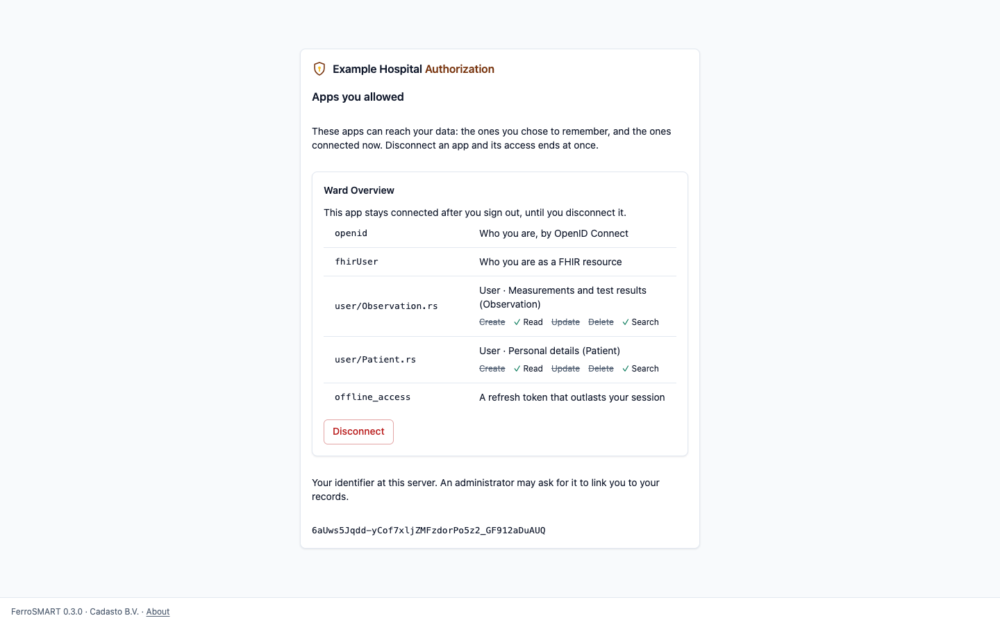

<!-- SPDX-FileCopyrightText: Cadasto B.V. -->
<!-- SPDX-License-Identifier: BUSL-1.1 -->

# Clients, roles and consent

Who may ask for what is content in the configuration, never code. Three
things decide the scope an app gets, and the narrowest wins:

1. the client's **ceiling**, the scopes its `[[ferrosmart.client]]` table
   lists;
2. the **roles** the person holds at the identity provider, each mapped by a
   `[[ferrosmart.role]]` table to the `user/` and `patient/` scopes it allows;
3. the **consent** the person gives on FerroSMART's consent page.

SMART lets the granted scope differ from the request and has the server's
policy win (SMART App Launch 2.2.0, Obtain access token, Response; Scopes
and Launch Context, SMART's scopes are used to delegate access). The token
response's `scope` always says what was granted. The resource server still
applies its own rules on top.

## The client registry

Each `[[ferrosmart.client]]` table registers one client. FerroSMART writes
the tables to its database at start, so every replica sees the same
registry; the configuration is the place to change a client.

| Key | What it is |
|---|---|
| `client_id` | The client's id, as the app sends it |
| `name` | The name the consent page shows the person |
| `kind` | `public`, `confidential_symmetric` or `confidential_asymmetric` |
| `jwks_uri` | A confidential asymmetric client's JWK Set URL, `https`; exclusive with `jwks_file` |
| `jwks_file` | A file holding the client's JWK Set by value |
| `secret_hash_file` | A file holding the Argon2id hash of a confidential symmetric client's secret, never the secret |
| `redirect_uris` | The client's complete redirect URIs, compared by exact string |
| `launch_uri` | Optional: the app's launch URL, absolute `https`, by which an EHR's [launch registration](../integrate/ehr-launch.md) may name the app (`app_launch_uri`), as a SMART Task does; compared after RFC 3986 normalization, one client per URL |
| `scopes` | The ceiling: every scope the client may ever be granted |
| `grant_types` | Any of `authorization_code`, `client_credentials` and `refresh_token` |

FerroSMART refuses at start a client that breaks one of these rules:

- a client lists at least one grant type;
- a `public` client registers no JWK Set and cannot use
  `client_credentials`, since that grant authenticates with a key;
- a `confidential_asymmetric` client registers exactly one of `jwks_uri` and
  `jwks_file`, and every key in the set carries `kty` and `kid` and the bare
  public members (`n` and `e`, or `crv`, `x` and `y`), and no private part;
- a `confidential_symmetric` client registers a `secret_hash_file` whose
  Argon2id hash is at least `m=19456,t=2,p=1`, no JWK Set, and never
  `client_credentials`, which SMART keeps for asymmetric clients;
- `refresh_token` comes with `authorization_code`;
- `authorization_code` comes with at least one redirect URI.

### The three kinds of client

| Kind | SMART capability | How it authenticates |
|---|---|---|
| `public` | `client-public` | PKCE alone; a browser or native app that keeps no secret |
| `confidential_symmetric` | `client-confidential-symmetric` | Its client secret, by HTTP Basic (`client_secret_basic`) or in the form (`client_secret_post`), never both in one request |
| `confidential_asymmetric` | `client-confidential-asymmetric` | A client assertion, `private_key_jwt`, signed `RS384` or `ES384` with a key of its registered JWK Set |

SMART prefers asymmetric authentication for a client that can hold a key
pair; the symmetric kind is for an app that can keep a secret and nothing
more. FerroSMART stores only the secret's hash. Make it with:

```sh
printf '%s' "$secret" | ferrosmart client hash-secret > portal-secret.phc
```

The command reads the secret on standard input and prints its Argon2id
hash with a fresh salt; give the client the secret and FerroSMART the file.

The client assertion follows SMART App Launch 2.2.0, Client Authentication:
Asymmetric: `iss` and `sub` the `client_id`, `aud` the token endpoint URL
or the issuer, `exp` at most five minutes ahead, a `jti` used once, `typ`
`JWT`. A `client_id` sent beside it must be the `iss`, a `jku` header must
equal the registered JWK Set URL, and exactly one key of the set must match
the `kid` and the algorithm's key type. A JWK Set fetched by URL is cached
no longer than its `Cache-Control` allows. Any failure answers
`invalid_client`.

### Examples

A SMART app a person launches, which may stay signed in:

```toml
[[ferrosmart.client]]
client_id = "growth-chart"
name = "Growth chart"
kind = "public"
redirect_uris = ["https://growth-chart.example.org/callback"]
scopes = ["openid", "fhirUser", "launch", "launch/patient",
          "patient/Observation.rs", "online_access"]
grant_types = ["authorization_code", "refresh_token"]
```

A web app with a server that keeps a secret:

```toml
[[ferrosmart.client]]
client_id = "portal"
name = "Patient portal"
kind = "confidential_symmetric"
secret_hash_file = "/run/secrets/portal-secret.phc"
redirect_uris = ["https://portal.example.org/callback"]
scopes = ["openid", "fhirUser", "launch/patient", "patient/Observation.rs"]
grant_types = ["authorization_code", "refresh_token"]
```

A system with no person, SMART Backend Services:

```toml
[[ferrosmart.client]]
client_id = "bulk-export"
name = "Bulk export"
kind = "confidential_asymmetric"
jwks_uri = "https://export.example.org/jwks.json"
scopes = ["system/Patient.rs", "system/Observation.rs"]
grant_types = ["client_credentials"]
```

Three scopes are FerroSMART's own `system/` scopes, which a client's ceiling
lists to reach an endpoint of FerroSMART itself:

| Scope | What it opens |
|---|---|
| `system/introspect` | `POST /introspect`, for a resource server that introspects ([the flows](../integrate/flows.md#refresh-introspection-and-revocation)) |
| `system/launch.c` | `POST /launch` and the signed launch JWT, for an EHR ([the EHR launch API](../integrate/ehr-launch.md)) |
| `system/AuditEvent.rs` | `GET /audit`, for an operator's client ([audit records](../operate/audit.md#reading-the-records)) |

## Roles

A `[[ferrosmart.role]]` table names a role as the identity provider's role
claims carry it, and the scopes a person holding it may be granted:

```toml
[[ferrosmart.role]]
name = "clinician"
scopes = ["user/Patient.rs", "user/Observation.rs", "patient/Observation.rs"]
```

A role grants only `user/` and `patient/` scopes and extension scopes,
has a name with no space, and is named once. An extension scope is any
scope that starts with two underscores, such as FerroEHR's
`__ferroehr.platform` (SMART App Launch 2.2.0, Scopes and Launch Context,
Extensibility): a resource server defines it for an API of its own. A
person is granted one only when the request asks for it, the client's
ceiling lists it and one of the person's roles grants it; a request alone
never grants it. The discovery document lists every extension scope a
role grants in `scopes_supported`, and the consent page names it in plain
words beside the SMART scopes:

```toml
[[ferrosmart.role]]
name = "administrator"
scopes = ["user/Patient.rs", "__ferroehr.platform"]
```

Any other scope outside the SMART set is never granted to a person. `[ferrosmart.upstream] role_claims` says where in the ID
Token the roles are ([identity providers](../install/upstream.md)).

## Which scopes the consent page offers

FerroSMART matches each requested scope as written against these rules,
drops the rest, and shows the person what remains:

| Requested scope | Offered when |
|---|---|
| `openid` | the ceiling lists it |
| `fhirUser` | the ceiling lists it, `openid` is offered, and the identity provider carries the person's `fhirUser` |
| `user/...` | the ceiling lists it and one of the person's roles grants it |
| `patient/...` | the ceiling lists it, a role grants it, and a patient is in context |
| `launch` | the ceiling lists it and the request carries an EHR launch |
| `launch/patient` | the ceiling lists it and a patient is in context: the EHR launch named one, or the patient picker can choose one |
| `launch/encounter` | the ceiling lists it and an encounter is in context: the EHR launch named one, or, with `launch/patient` at a FHIR server, the patient picker can choose one |
| `offline_access`, `online_access` | the ceiling lists it and the client registers `refresh_token` |
| `__...` (an extension scope) | the ceiling lists it and one of the person's roles grants it |

With both refresh scopes granted, `offline_access` decides.

## Consent

Every flow with a person shows the consent page, unless the organisation
approved the app (below). The person approves the offered scopes, unticks
any, or refuses, which sends the app an `access_denied` error. FerroSMART draws the page itself, with the
deployment's name and `consent_text` from `[ferrosmart.branding]`.

When the person ticks "Remember this choice", FerroSMART keeps the consent
for that client and that scope set. A later request whose offered scopes it
covers goes back to the app with a code at once; a request for more shows
the page again. The person sees each remembered consent at
`{issuer}/manage`, the SMART `management_endpoint`, and withdraws it there,
which revokes the grants it covered with every token under them. The page
also lists every app that still holds `offline_access` or `online_access`,
remembered or not, and says how long it stays connected.

### An app the organisation approved

An administrator can approve one of the organisation's own apps once for
its staff, so a professional who opens it sees no consent page (SMART App
Launch 2.2.0, Obtain authorization code, Response: the server "will enforce
access rules based on local policies and optionally direct end-user
input"):

```toml
[ferrosmart.client.organisation_approval]
scopes = ["openid", "fhirUser", "launch", "user/Observation.rs"]
approved_by = "J. de Vries, information security"
approved_at = "2026-11-19T09:00:00Z"
```

The approval lists only `user/` scopes and the launch, OpenID, refresh and
extension scopes that go with them, each within the client's `scopes`. The
page is skipped when the request names no `patient/` scope, the person's
`fhirUser` is not a `Patient`, `RelatedPerson` or `Person`, and the
approval covers every scope offered; the person still gets no more than
their roles allow. Anything else shows the page as usual. Each skipped page
writes an audit record naming the approver and the time, and the
management page lists the app as approved by the organisation, which the
person cannot withdraw there. Remove or change the table and restart: the
approval is withdrawn, and every token issued on it is revoked.



The management page, with one app that keeps access.
[Dark theme](../integrate/img/manage-dark.png).

The consent and management pages read each scope in words, with plain
words before the common FHIR resource types, such as "Measurements and test
results (Observation)".

Backend Services tokens live at most five minutes, whatever
`access_token_lifetime` says (SMART App Launch 2.2.0, Backend Services).

Backend Services has no person and no consent: the client's ceiling is its
pre-authorization (SMART App Launch 2.2.0, Backend Services).
